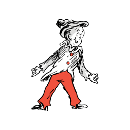

<svelte:head>
	<title>Motti</title>
</svelte:head>

	<button class="egg-btn" aria-label="Poke Eric" onclick={() => egg?.play()}></button>
	<StiltsEgg bind:this={egg} {pic} />

	# Hi there, I'm Motti 👋

	🎓 Grad student @ [WashU](https://www.google.com/search?q=washu) | Infra & Tools @ Deere 

	<SocialLinks />

	<nav class="next">
		<a href="/about">more about me →</a>
		{#if page.data.latestNote}
			<a href="/notes/{page.data.latestNote.slug}">latest note {page.data.latestNote.title} →</a>
		{/if}
	</nav>

